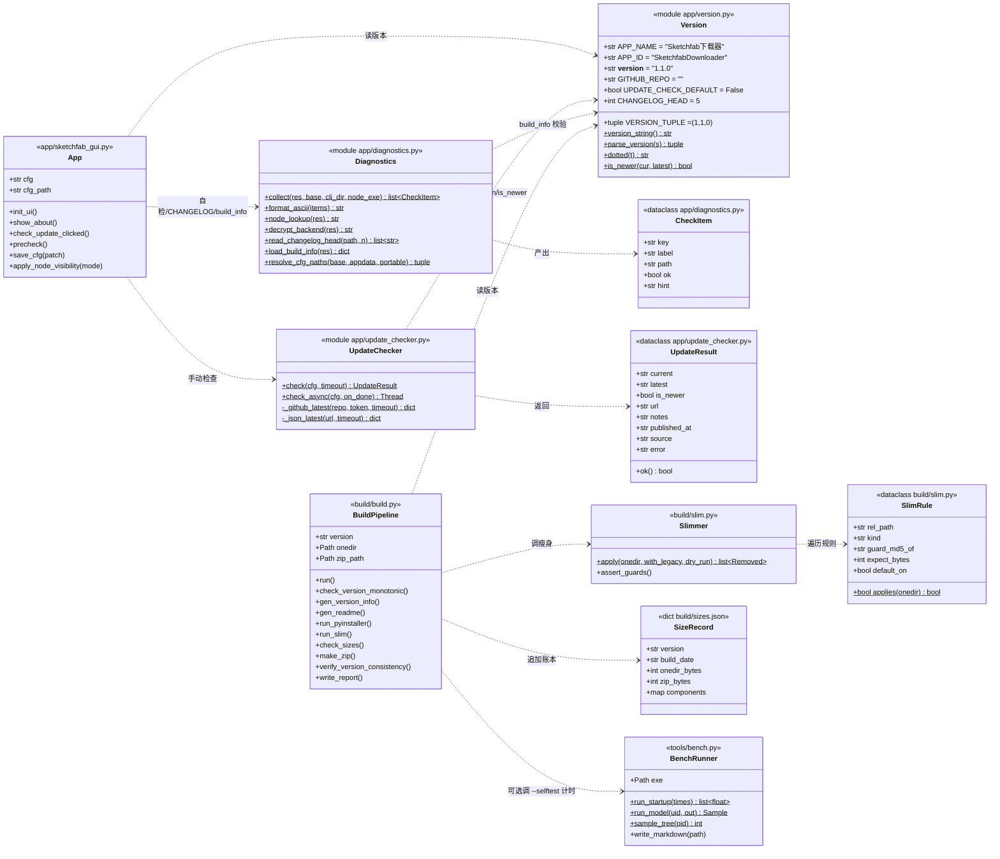
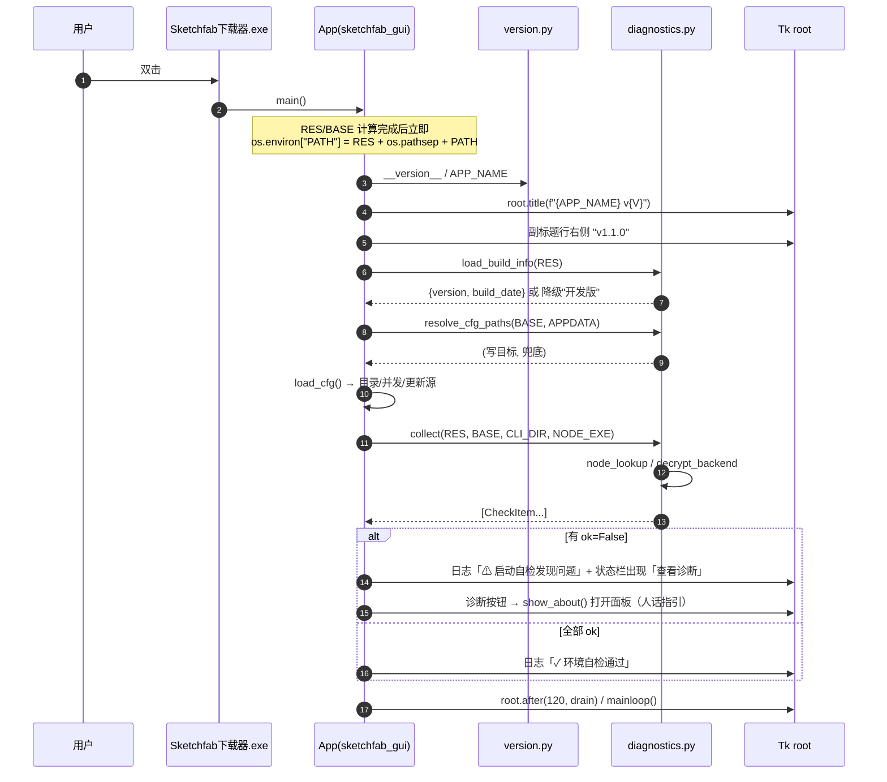
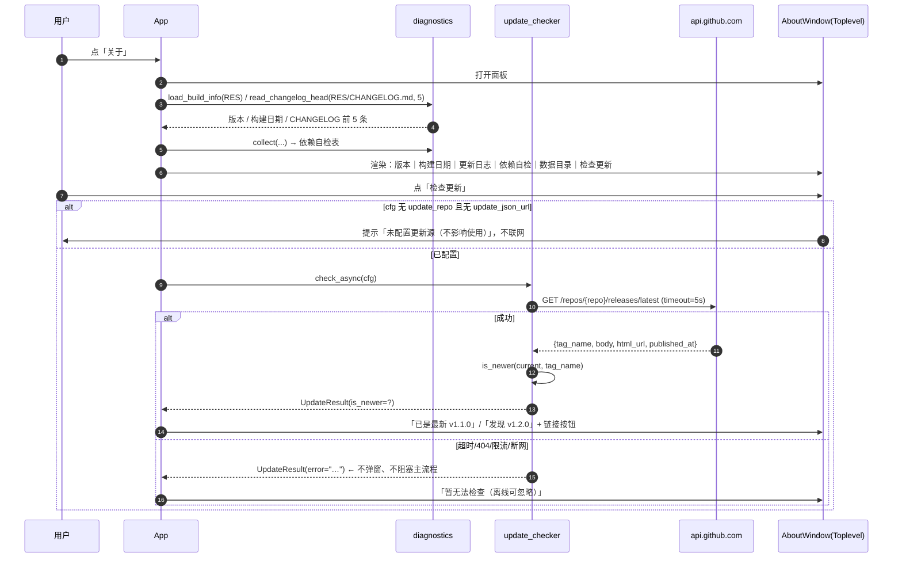
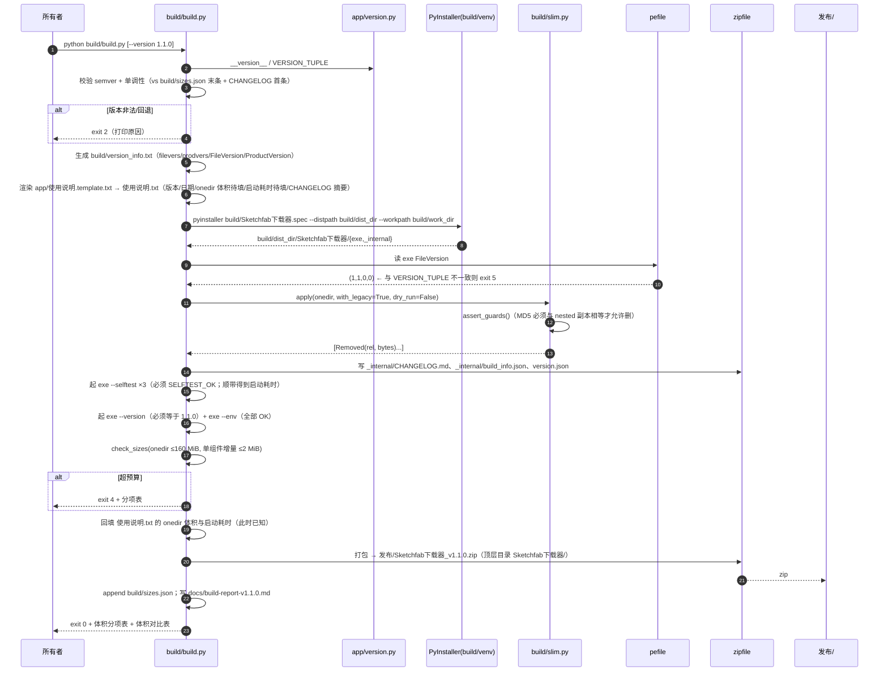
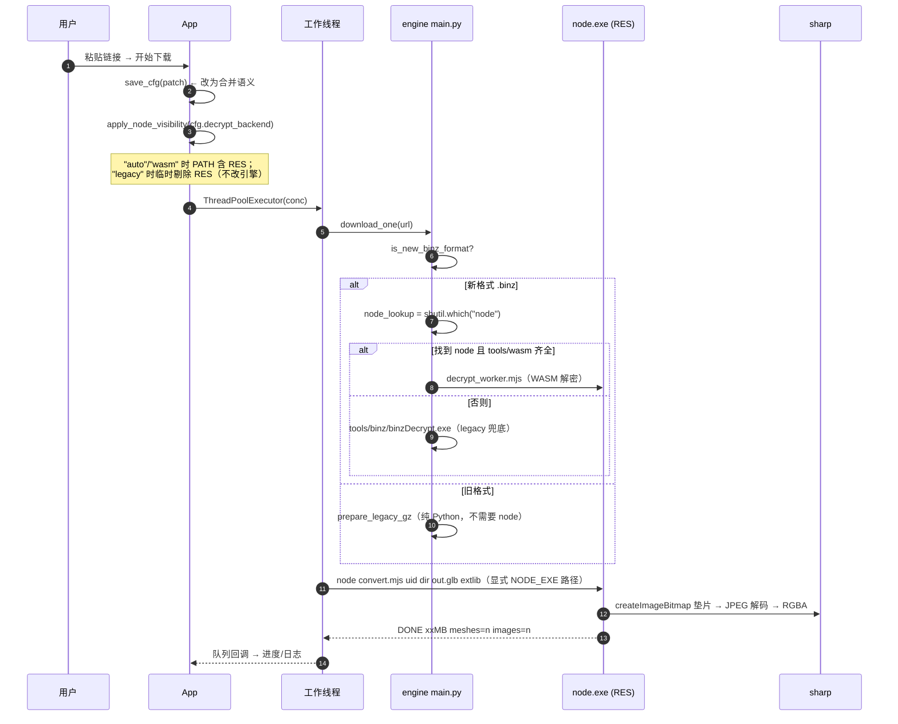
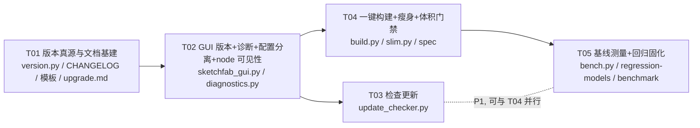

# 架构设计 · Sketchfab 模型下载器 v1.1

> 撰写人：高见远（架构师）　依据：`docs/PRD-增量-v1.1.md`（许清楚）
> 范围：**只做设计 + 任务分解，不写实现代码**。v1.1 只落地「版本体系 + 一键构建 + 零风险瘦身 + 基线测量 + 配置分离」，Node→Pillow（v1.2）与 glTF 层重写（v1.3）本次只留接口位置。
> 本设计与 PRD 的 M1~M7、R1~R13 逐条对齐；对齐结果见第 10 节。

---

## 1. 实现方案总览

### 1.1 核心难点与对策（按难度排序）

| 难点 | 本质 | 对策 |
|---|---|---|
| **版本号四处一致**（M5） | tkinter 程序没有「构建产物元信息」这一层，`version_info.txt` 是手写常量 | 单一真源 = `app/version.py`；`build/build.py` **生成** `version_info.txt`，构建末尾再用 `pefile` 读 exe 属性 + 跑 `exe --version`，与 `version.py` 三方比对，不一致直接构建失败 |
| **瘦身不能靠「看起来没用」** | 删 DLL/包是唯一可能把可用包变砖的操作 | 每条删除规则都带**可判定的守卫**（MD5 相等断言 / 引用扫描结论），并在包生成后跑 `--env` + `--selftest` + 真模型转换；规则集中在 `build/slim.py`，可 `--dry-run` 预演 |
| **一键构建要可复现** | 现在是手敲 PyInstaller 长命令，spec 内全是绝对路径 | spec 改为 `__file__` 相对路径；所有输入（版本/日期/CHANGELOG/说明模板）由 `build.py` 组装；输出 `发布/Sketchfab下载器_v1.1.0.zip` + 体积报告 + 追加 `build/sizes.json` |
| **更新检查「离线优先、默认不联网」** | 无服务器、仓库还没建、私有仓库合规优先 | `update_checker` 三态设计：未配置 → 不联网（按钮显示「未配置更新源」）；配置 repo → 仅手动点击联网（5 s 超时，失败静默）；可选 token 支持私有仓库。**永不后台自动联网** |
| **基线测量（M4 现为「未测」）** | 需要一个不属于发布物的测量工具 | `tools/bench.py`（仅开发用，不进包）：psutil 采样整个进程树，量「峰值 RSS / 总耗时 / GLB 大小 / 实际解密后端」，写 `docs/benchmark-v1.1.md` |
| **Node 是否被引擎找到**（本次新发现，见 9.1） | 引擎用 `shutil.which("node")`，而 node.exe 在 `_internal/`，不在 PATH | GUI 启动时把 `RES` 前置进 `PATH`；`--env` 增打 `NODE_LOOKUP` 与 `DECRYPT_BACKEND`，让「实际走哪条解密路径」变成可观测事实 |

### 1.2 技术选型

不引入新框架、不引入新运行时依赖。全部用现有栈：

- GUI：继续 tkinter（PRD 非目标 2 明确不重写），「关于/诊断」用 `tk.Toplevel` + `ttk`，复用现有 `style` 与配色常量。
- 构建：继续 PyInstaller 6.22.3（`build/venv` 已装）+ Python 标准库 `zipfile/hashlib/subprocess/urllib`。
- 版本比对/exe 版本读取：`pefile`（**已在** `build/venv`，只构建期用）。
- 更新检查：标准库 `urllib.request` + `json`（与现有 `fetch_info` 同风格，不引入 requests 依赖到 GUI 层）。
- 内存采样：`psutil`，**仅 dev-only**（只出现在 `tools/bench.py`，绝不进 PyInstaller 依赖图，理由见 6.2）。

### 1.3 架构分层

```
┌──────────────────────── 发布物（onedir zip）────────────────────────┐
│ Sketchfab下载器.exe                                                  │
│ _internal/                                                          │
│   ├─ sketchfab_gui.pyc(PYZ)  ← 入口，含 App / cli_mode               │
│   │      ├── diagnostics       (依赖自检 / CHANGELOG / build_info)   │
│   │      ├── update_checker    (可选，默认关闭)                       │
│   │      └── version           (常量，唯一版本真源)                   │
│   ├─ CHANGELOG.md            ← 新增，关于面板离线读                  │
│   ├─ build_info.json         ← 新增，构建期生成（日期/体积/提交）      │
│   ├─ engine/ (dist_engine)    ← 下载引擎，不改造                      │
│   ├─ node.exe / convert.mjs / extlib / node_modules                  │
│   └─ Python 运行时                                                    │
│ version.json                 ← 新增，包根，给「检查更新」/排障看      │
└─────────────────────────────────────────────────────────────────────┘
        ▲ 由 build/build.py 一条命令生产；slim.py 负责瘦身与守卫
```

构建期与运行期**严格分离**：`build/`、`tools/`、`docs/` 永不进包；包内只多 3 个新文件（`CHANGELOG.md`、`build_info.json`、`version.json`）。

---

## 2. 文件列表

路径均相对 `C:\Users\user\Sketchfab下载\`。

### 2.1 新增

| 文件 | 作用 | 归属任务 |
|---|---|---|
| `app/version.py` | 版本单一真源（含 `__version__`/`VERSION_TUPLE`/`parse_version`/`GITHUB_REPO`） | T01 |
| `app/diagnostics.py` | 依赖自检、CHANGELOG 读取、`build_info` 读取、配置路径解析（`--env`/关于面板/`precheck` 共用一份） | T02 |
| `app/update_checker.py` | GitHub Release / 静态 `version.json` 更新检查（默认关闭） | T03 |
| `app/使用说明.template.txt` | 使用说明模板（占位符注入） | T01 |
| `CHANGELOG.md` | Keep-a-Changelog，v1.0.0 追认 + v1.1.0 | T01 |
| `version.json` | 仓库根示例 + 构建时拷进包根 | T01 |
| `build/build.py` | 一键构建主控 | T04 |
| `build/slim.py` | 瘦身规则引擎（带守卫，可 `--dry-run` 单独跑） | T04 |
| `build/sizes.json` | 体积基线账本（每版追加一条，替代 git tag 做「上一版对比」） | T04 |
| `tools/bench.py` | 内存/启动/回归测量（dev-only） | T05 |
| `docs/regression-models.md` | M6 六模型固化清单 | T05 |
| `docs/benchmark-v1.1.md` | 基线测量结果（M4 交付物） | T05 |
| `docs/upgrade.md` | 覆盖解压升级三步 + 数据目录 | T01 |
| `docs/class-diagram.mermaid` / `docs/sequence-diagram.mermaid` | 图单独落盘，便于工程师对照 | 本次交付 |
| `docs/build-report-v1.1.0.md` | 每版构建自动生成（体积分项 + 增量） | T04 生成 |

### 2.2 修改

| 文件 | 改动 |
|---|---|
| `app/sketchfab_gui.py` | 标题/副标题版本、关于面板、`--version`、`--env` 改走 diagnostics、PATH 前置 RES、配置读写新规则 + **合并式保存**、`precheck` 复用 diagnostics（可点开诊断）、`decrypt_backend` 开关 |
| `build/Sketchfab下载器.spec` | 绝对路径 → `SPECPATH` 相对路径；新增 datas：`CHANGELOG.md`、`build_info.json`；版本文件路径参数化 |
| `build/version_info.txt` | **改为构建产物**（由 `build.py` 从 `version.py` 生成；仓库保留 `.gitignore` 语义的「不再手改」约定） |
| `app/使用说明.txt` | **删除**（改由模板生成到发布物，避免双真源）；源码树不再保留手写版 |

### 2.3 不动（明确冻结）

`dist_engine/**`（下载协议核心，PRD 非目标 3）、`sketchfab-cli-main/**`（引擎源）、`app/convert.mjs`、`app/extlib/**`、`app/node_modules/**`、`app/启动下载器.bat`、`app/icon.ico`。

---

## 3. 数据结构与接口

### 3.1 类图



### 3.2 `app/version.py`（唯一真源）

```python
# 全部都是模块级常量，零 import，允许 build 期被 build.py 直接读取
APP_NAME   = "Sketchfab下载器"
APP_ID     = "SketchfabDownloader"      # exe InternalName
__version__ = "1.1.0"                   # ← 改版本号只改这一行
VERSION_TUPLE = (1, 1, 0)               # 与 __version__ 必须一致（module import 时断言）

GITHUB_REPO = ""            # "owner/name"；空 = 更新检查整体关闭（默认）
UPDATE_CHECK_DEFAULT = False # 若 GITHUB_REPO 非空，是否默认开启「启动不检查、只手动可点」
CHANGELOG_HEAD = 5           # 关于面板展示条数
SINGLE_FILE_EXPERIMENTAL = False  # 单文件 exe 是否构建（v1.1 默认否）

def version_string() -> str: ...          # "1.1.0"
def parse_version(s: str) -> tuple: ...   # "1.2.3-beta" -> (1,2,3)  容错: 非法返回 ()
def dotted(t: tuple) -> str: ...
def is_newer(cur: str, latest: str) -> bool: ...   # 逐段整数比较
```

约束：`version.py` **不得 import 任何东西**（tkinter/PyInstaller 都不能碰），否则 `build.py` 无法在无 GUI 环境下安全读取。

### 3.3 `app/diagnostics.py`

```python
@dataclass
class CheckItem:
    key: str        # "engine" | "node" | "convert" | "sharp" | "wasm" | "changelog" | "build_info" | "libvips_dup"
    label: str      # 中文人话，给关于面板/日志用
    path: str
    ok: bool
    hint: str = ""  # 缺了怎么办（R11 要求「人话指引」）

def collect(res: Path, base: Path, cli_dir: Path, node_exe) -> list[CheckItem]
    # 逐项检查：engine/main.py、node.exe、convert.mjs、node_modules/sharp、
    # engine/tools/wasm/{decrypt_worker.mjs,decrypt.wasm}、CHANGELOG.md、build_info.json
    # 额外提示：若 _internal/libvips-*.dll 存在（说明瘦身没生效）→ ok=True 但 hint 标注

def format_ascii(items: list[CheckItem]) -> str      # --env 的纯 ASCII 输出（GBK 控制台安全）
def node_lookup(res: Path) -> str                    # shutil.which("node") 结果，空串=未找到
def decrypt_backend(res: Path) -> str                # "wasm" | "legacy" | "none"（照 engine/decrypt_binz 的分支条件复刻判断）
def read_changelog_head(path: Path, n: int = 5) -> list[str]   # 解析 "## [x.y.z]" 段落首条描述
def load_build_info(res: Path) -> dict               # 读不到返回 {"version": <version.py>, "build_date": "开发版"}
def resolve_cfg_paths(base: Path, appdata: Path, portable: bool) -> tuple[Path, Path]
    # 返回 (读优先路径, 写目标)；规则见 3.6
```

`decrypt_backend()` 是本次的关键可观测点：它按引擎真实分支条件判断（`node_lookup()` 非空 且 wasm 齐全 → `"wasm"`；否则 `binzDecrypt.exe` 存在 → `"legacy"`；都没有 → `"none"`），用于证明「PATH 修复后到底走哪条路」。

### 3.4 `app/update_checker.py`

```python
@dataclass
class UpdateResult:
    current: str = ""
    latest: str = ""
    is_newer: bool = False
    url: str = ""            # Release 页面 / 下载链接
    notes: str = ""          # release body 前 800 字
    published_at: str = ""   # ISO8601
    source: str = ""         # "github" | "json" | ""
    error: str = ""          # 非空 = 失败，UI 静默处理（PRD R9 硬性要求）
    def ok(self) -> bool: return not self.error

def check(cfg: dict, *, timeout: float = 5.0) -> UpdateResult
    # 依据 cfg 决定用哪种源：
    #   1) cfg["update_repo"]（"owner/name"）非空 → GitHub Release
    #   2) cfg["update_json_url"] 非空   → 静态 version.json
    #   3) 都空 → UpdateResult(error="未配置更新源")，**不发起任何网络请求**
    # 任何异常（超时/DNS/JSON 错/限流/证书）→ 捕获成 error 字段返回，绝不抛出

def check_async(cfg: dict, on_done: Callable[[UpdateResult], None]) -> threading.Thread
    # daemon 线程执行 check()，结果经 App.q 回到主线程（Tk 变量只在主线程碰）

def _github_latest(repo: str, token: str, timeout: float) -> dict
    # GET https://api.github.com/repos/{repo}/releases/latest
    # Header: Accept: application/vnd.github+json, User-Agent: <APP_NAME>/<version>
    #        有 token 时加 Authorization: Bearer <token>（私有仓库必需）
def _json_latest(url: str, timeout: float) -> dict
    # GET url → {"version","url","notes","published_at"}
```

**私有仓库取舍（写入设计，供所有者决策）**

| 方案 | 可行性 | 代价 |
|---|---|---|
| 私有仓库 + 无 token | ❌ 不可行，API 对未认证请求返回 404 | — |
| 私有仓库 + fine-grained PAT（`Contents: Read-only`） | ✅ 可行 | token 只能明文存 `config.json`，泄露面 = 本机文件；而本工具本来就不公开分发，风险可接受。建议 README 注明「只勾 Release 只读」 |
| **不做更新检查（`GITHUB_REPO=""`）** | ✅ 默认状态 | 需要用户自己知道有新版本 —— 与 PRD「不希望程序偷偷联网」一致 |

结论：默认「不配置 = 不联网」；配置后仅手动检查；token 项在关于面板留输入框但**默认折叠隐藏**，说明「私有仓库才需要」。

### 3.5 数据文件结构

`version.json`（包根，构建生成；仓库根同构，作为「更新源」发布示例）

```json
{
  "schema": 1,
  "app": "sketchfab_downloader",
  "version": "1.1.0",
  "build_date": "2025-11-01",
  "channel": "stable",
  "url": "https://example.com/Sketchfab下载器_v1.1.0.zip",
  "notes": "v1.1.0：版本体系 / 一键构建 / 瘦身 181→153MB / 配置与程序分离",
  "min_version": "1.0.0"
}
```

`_internal/build_info.json`（构建期生成，运行期只读，缺失时降级为「开发版」）

```json
{
  "version": "1.1.0",
  "build_date": "2025-11-01T12:34:56+08:00",
  "python": "3.11.5",
  "pyinstaller": "6.22.3",
  "engine_sha": "…8位…",
  "slim_rules": ["libvips-dup", "sharp-wasm32", "emnapi", "tslib"],
  "onedir_mb": 153.2,
  "zip_mb": 66.4
}
```

`build/sizes.json`（体积账本，`build.py` 每版 append；代替不存在的 git tag 做「上一版对比」）

```json
[{"version":"1.0.0","build_date":"2025-10-31","onedir_bytes":189792256,"zip_bytes":85437687,
  "components":{"node.exe":87031808,"libvips_dup":19275776,"binzDecrypt.exe":18766080,
                "sharp_wasm32":9437184,"sharp_win32_x64":19922944,"engine":19922944}}]
```

`docs/regression-models.md`（M6 固化清单，表格一行一个模型）

```markdown
| # | 类别 | UID / 链接 | 关注点 | GLB 期望结构 |
|---|------|-----------|--------|--------------|
| 1 | 4K 贴图 | <32位UID> | 峰值 RSS 上限 | textures=1..n, 2048+ |
| 2 | 骨骼绑定 | <UID> | skin/joints 不退化 | skins>=1 |
| 3 | 多材质 | <UID> | 材质数一致 | materials>=2 |
| 4 | 大面数 | <UID> | 耗时/内存 | meshes>=1 |
| 5 | 无贴图 | <UID> | images=0 不报错 | images=0 |
| 6 | 短链 | https://skfb.ly/p9HSv | 跳转解析 | 同 1 |
```

### 3.6 配置读写规则（R7）

```python
def resolve_cfg_paths(base, appdata, portable=False):
    base_cfg = base / "config.json"
    app_cfg  = appdata / "Sketchfab下载器" / "config.json"
    tgt = base_cfg if (portable or base_cfg.exists()) else app_cfg   # 便携模式优先
    other = app_cfg if tgt == base_cfg else base_cfg
    return (tgt, other)     # (写目标, 读兜底)
```

- 写：**只写一个**（不再像现在这样 BASE 失败才退 APPDATA），保证单真源。
- 读：先写目标，再兜底另一个（老版本遗留配置仍能读到）。
- **`save_cfg` 改为合并语义**：`save_cfg({"out_dir":..., "concurrency":...})` 必须 merge 进已加载的 cfg 再落盘。当前实现是整体覆盖 dict，会抹掉 `update_repo` 等新键 —— 这是 R9 的前置缺陷，必须一起修。
- 发布包内**不得包含 config.json**：`build.py` 增加断言（存在即构建失败），这是「覆盖解压不丢设置」的硬保证。
- `--portable` 命令行开关强制写 BASE。

---

## 4. 程序调用流程

### 4.1 启动 → 版本可见 → 自检（R1/R2/R11/M5）



### 4.2 关于面板 + 手动检查更新（R2/R3/R9）



### 4.3 一键构建（R4/M1/M2/M5/M7/R13）



> 说明「先瘦身后填数字」：`使用说明` 注入 onedir 真实体积与实测启动耗时，这两项都在瘦身/自检之后才确定；`使用说明` 因**不写 zip 体积**（改为「下载体积见发布页」），整条流水线只需一遍打包，避免两遍压缩的复杂度。

### 4.4 下载 + 转换（现有主链路，标注本次改动点）



---

## 5. 任务列表（按实现顺序，可直接开工）

> 硬约束：**5 个任务**，每任务 ≥3 个文件，T01 为基础设施，任务间尽量并行。工程师照此顺序执行即可。

### T01 · 版本真源与发布文档基建
- **优先级**：P0　**依赖**：无
- **改动文件**：
  - `app/version.py`（新）
  - `CHANGELOG.md`（新，Keep-a-Changelog：`## [1.1.0]` + `## [1.0.0]` 追认）
  - `app/使用说明.template.txt`（新，从现有 `使用说明.txt` 迁移并去掉所有写死数字）
  - `version.json`（新，仓库根示例）
  - `docs/upgrade.md`（新，三步升级 + 数据目录说明）
- **要点**：
  1. `version.py` 零 import；`assert VERSION_TUPLE == tuple(int(x) for x in __version__.split("."))` 置于模块尾。
  2. 模板占位符**只有 6 个**：`{{VERSION}} {{BUILD_DATE}} {{SIZE_ONEDIR_MB}} {{STARTUP_SEC}} {{CHANGELOG_TOP5}} {{PYTHON_VER}}`；除这些外模板不得出现任何体积/版本数字（原「150MB/40秒/1.7秒」全部删除或改为占位）。
  3. `CHANGELOG.md` 的 v1.1.0 段先写「计划项」，构建时 `build.py` 只取标题行做摘要，不解析正文格式。
- **验收**：`python app/version.py` 输出 `1.1.0`；`grep -n "[0-9]\+MB\|[0-9]\+ ?秒" app/使用说明.template.txt` 无命中；CHANGELOG 两条版本齐全。

### T02 · GUI 版本可辨识 + 诊断面板 + 配置分离 + node 可见性
- **优先级**：P0　**依赖**：T01
- **改动文件**：
  - `app/sketchfab_gui.py`（改）
  - `app/diagnostics.py`（新）
  - `app/使用说明.txt`（删除，改由模板生成）
- **要点**：
  1. **M5 三处视觉/输出**：`root.title(f"Sketchfab 模型下载器 v{__version__}")`；`head` 内副标题行右侧加 `ttk.Label(style="Sub.TLabel")` 显示 `v1.1.0`（用 `pack(side="right")` 放在同一行 frame）；`--version` 打印 `Sketchfab下载器 v1.1.0 (build 2025-11-01)`，`--version --json` 打印 JSON。
  2. **PATH 前置 RES**（放在 `RES/BASE` 计算之后、任何引擎/子进程调用之前）：`os.environ["PATH"] = str(RES) + os.pathsep + os.environ.get("PATH", "")`。
  3. `--env` 改为调 `diagnostics.format_ascii(collect(...))`，**必须新增三行**：`NODE_LOOKUP`、`DECRYPT_BACKEND`、`BUILD`（build_info 摘要）。保留原有 `RES/BASE/ENGINE/NODE/CONVERT/SHARP/WASM/EXTLIB` 行以兼容既有排障习惯。
  4. **`show_about()`**：`tk.Toplevel`，只读文本区展示 版本 / 构建日期 / 数据目录 / 配置路径 / CHANGELOG 前 5 条（`ScrolledText`）+ 依赖自检表格（`ttk.Treeview`，列：项/状态/路径）+ 底部按钮「检查更新」「打开数据目录」「关闭」。入口按钮放在工具栏 `清空日志` 左侧。P1 的检查更新按钮先占位（T03 接）。
  5. `precheck()` 复用 `collect()`；有问题时在状态栏显示「⚠ 发现 N 项问题，点『关于/诊断』查看」。
  6. config：`resolve_cfg_paths` + 合并式 `save_cfg(patch)`（见 3.6）；`--portable` 开关；启动时把实际配置路径存 `self.cfg_path` 供面板展示。
  7. `decrypt_backend` 配置（`auto|wasm|legacy`，默认 `auto`）+ `apply_node_visibility()`：`legacy` 时把 RES 从 PATH 临时剔除，让引擎回落到 `binzDecrypt.exe`；这是 9.1 结论要求的「一键回滚开关」，不改引擎一行代码。
  8. `--selftest` 行为保持不变（仍然输出 `SELFTEST_OK` 并销毁窗口），不得因为新增面板而改动这条路径。
- **验收**：`set PATH=C:\Windows\System32 && Sketchfab下载器.exe --env` 显示 `NODE_LOOKUP=<...>\_internal\node.exe` 与 `DECRYPT_BACKEND=wasm`；`--selftest` 输出 `SELFTEST_OK`；标题/副标题/`--version` 均为 1.1.0；删掉 `_internal/node.exe` 后 `--env` 显示 `DECRYPT_BACKEND=legacy`。

### T03 · 检查更新（GitHub Release，默认关闭）
- **优先级**：P1　**依赖**：T02
- **改动文件**：
  - `app/update_checker.py`（新）
  - `app/sketchfab_gui.py`（改：接按钮 + 设置项 + 结果行）
  - `app/version.py`（改：`GITHUB_REPO` / `UPDATE_CHECK_DEFAULT` 实际取值 + 注释）
- **要点**：
  1. `check()` 三条分支（见 3.4），**未配置时零网络请求**（用 `unittest.mock` 或断网测试证明）。
  2. 超时 5 s；`urlopen(..., timeout=timeout)`；捕获 `URLError/HTTPError/socket.timeout/json.JSONDecodeError/Exception` 全落 `error` 字段。
  3. UI 侧：`check_async` + `App.q`（沿用现有队列），**不得**在 Tk 回调里做网络。
  4. 设置项写在关于面板里（`update_repo` 输入框 + `github_token` 折叠区），保存走合并式 `save_cfg`。
  5. 失败文案：`「暂无法检查（离线可忽略）」`，无 messagebox。
- **验收**：断网点「检查更新」→ ≤6 s 内出现结果行且不弹窗；填 `owner/name` 后能取到 `tag_name` 并与当前版本比较；清空后按钮提示「未配置更新源」。

### T04 · 一键构建 + 零风险瘦身 + 体积门禁
- **优先级**：P0　**依赖**：T01、T02
- **改动文件**：
  - `build/build.py`（新）
  - `build/slim.py`（新）
  - `build/Sketchfab下载器.spec`（改）
  - `build/version_info.txt`（改为构建产物）
  - `build/sizes.json`（新，先手填 v1.0.0 基线一条）
- **要点**：
  1. spec 路径全部改 `os.path.join(SPECPATH, "..")` 形式；`datas` 增加 `CHANGELOG.md`→`.`、`build_info.json`→`.`（后者由 build 生成到 `build/gen/`）；`version=` 指向生成后的 `build/version_info.txt`。
  2. `slim.py` 规则表见第 7 节，含 MD5 守卫与 `--dry-run`；守卫失败 exit 1 且**不删除**。
  3. 体积门禁：onedir ≤160 MiB（M1）、zip ≤72 MB（M2）、单组件相对上一版 +2 MiB 告警（R13）；超限 exit 4。
  4. 版本一致性：`pefile` 读 exe `FileVersion`、`exe --version`、`version.py` 三方；不一致 exit 5。
  5. 断言包内无 `config.json`、无 `使用说明.txt` 旧手写版、`_internal/CHANGELOG.md` 存在。
  6. 输出：`发布/Sketchfab下载器_v1.1.0.zip`（顶层目录 `Sketchfab下载器`，与 v1.0.0 一致，保证「覆盖解压」升级）、`docs/build-report-v1.1.0.md`、`build/sizes.json` 追加。
  7. 单文件 exe：`--single-file` 才构建，且不写入 `发布/`（`SINGLE_FILE_EXPERIMENTAL=False`）。默认**不产出** 82 MB 单文件版（PRD R14 精神）。
- **验收**：`python build/build.py` 一条命令出 zip；`build/` 里无任何绝对路径残留；连续跑两次结果可复现（zip 内文件数一致，体积差 <0.5 MB）；故意把 `version.py` 改成 `1.0.9` 时 exit 2。

### T05 · 基线测量 + 回归套件固化
- **优先级**：P0　**依赖**：T04
- **改动文件**：
  - `tools/bench.py`（新）
  - `docs/regression-models.md`（新）
  - `docs/benchmark-v1.1.md`（新）
  - `docs/build-report-v1.1.0.md`（补写结论段）
- **要点**：
  1. `bench.py` 只做三件事：`--startup`（`exe --selftest` ×3，取中位数与最小值）、`--model <uid>`（起 `exe --run`，100 ms 采样进程树 RSS）、`--all`（读 `docs/regression-models.md` 全跑）。
  2. 采样实现：`psutil.Process(pid)` + `children(recursive=True)`，累加 `memory_info().rss`；`peak = max(samples)`；子进程缺失时忽略。记录 `node.exe` 峰值单列（sharp 是内存大头，v1.2 要用）。
  3. 每模型记录：峰值 RSS(MB) / 总耗时(s) / GLB 大小(MB) / `meshes` `images` 计数 / **实际解密后端**（扫日志 `decrypt: WASM` / `decrypt: legacy`）。
  4. 输出 `docs/benchmark-v1.1.md`：一张 6 行表 + 一行「默认并发建议」；原始采样落 `docs/bench-raw/<uid>.json`。
  5. `docs/regression-models.md` 若 UID 未填，脚本跳过并打印「待所有者补全」。**这条是 M6 的阻塞项，见第 9 节 Q1**。
- **验收**：`docs/benchmark-v1.1.md` 6 行数据齐全；6 模型 GLB 成功率 100%；解密后端一栏有明确值（不是「未知」）。

### 任务依赖图



---

## 6. 依赖包清单

### 6.1 运行时（进包）：**零新增**

```
Python 3.11.5 标准库            json/os/re/subprocess/threading/urllib/zipfile/hashlib/pathlib/dataclasses
tkinter (随 Python)             GUI
requests/urllib3/certifi        v1.0.0 已有，hiddenimports 不变
Node 22 (node.exe) / sharp      v1.0.0 已有
```

### 6.2 构建期（不进包）

```
pyinstaller==6.22.3       已在 build/venv
pefile==2024.8.26         已在 build/venv（用于读 exe 版本属性，M5 校验）
psutil (新增, dev-only)   ← 仅 tools/bench.py 使用
```

**psutil 为什么安全**：PyInstaller 从**入口脚本** `app/sketchfab_gui.py` 出发静态分析依赖图；`tools/bench.py` 不在 `pathex`、不在 `Analysis.scripts`、不被 GUI import，因此 `psutil` 不可能被收进包。为防误收，`build.py` 构建后断言 `_internal` 下不存在 `psutil*`，存在则 exit 6。
**替代方案（若不愿装）**：用 `ctypes` + `Toolhelp32Snapshot` + `PROCESS_MEMORY_COUNTERS_EX.PeakWorkingSetSize` 纯标准库实现，代价约 100 行平台代码。架构上允许工程师在 psutil 安装受阻时切到这个方案（`bench.py --mem-tool ctypes`）。**v1.1 首选 psutil，理由是 20 行代码 vs 100 行，且不进包。**

---

## 7. 零风险瘦身清单（逐条落实到具体路径）

以下路径均相对包根 `build/dist_dir/Sketchfab下载器/`。**体积为实测值**（`du`/`ls` 实测于 2025-10-31 的产物）。

| # | 目标 | 路径 | 实测体积 | 守卫（不满足就拒绝删除） | 依据 |
|---|---|---|---|---|---|
| S1 | 重复 `libvips-42.dll` | `_internal/libvips-42.dll` | **19,018,240 B（18.1 MiB / 19.0 MB）** | MD5 **必须等于** `_internal/node_modules/@img/sharp-win32-x64/lib/libvips-42.dll`（实测同为 `86ac71eb65121e579786a7505738a31a`） | sharp 的 native 绑定在 `@img/sharp-win32-x64/lib/`，同目录 DLL 优先加载；顶层这份是 PyInstaller 顺手收集的副本 |
| S2 | 重复 `libvips-cpp-8.18.7.dll` | `_internal/libvips-cpp-8.18.7.dll` | **333,312 B（0.3 MiB）** | MD5 必须等于 `_internal/node_modules/@img/sharp-win32-x64/lib/libvips-cpp-8.18.7.dll`（同为 `6379d4c87a9930d8b2a4ca000e9ca40f`） | 同上 |
| S3 | WASM 版 sharp（永不加载） | `_internal/node_modules/@img/sharp-wasm32/`（整目录） | **9.0 MiB，其中 `lib/sharp-wasm32-0.35.5.node.wasm` 8.7 MiB** | `_internal/node_modules/@img/sharp-win32-x64/lib/sharp-win32-x64-0.35.5.node` 必须存在（win32-x64 原生绑定在位，`sharp/dist/sharp.cjs` 的 `require("@img/sharp-wasm32/sharp.node")` 只在原生加载失败时才会执行） | 代码引用已核实：仅 `sharp.cjs:99` 的 catch 分支 |
| S4 | `@emnapi` | `_internal/node_modules/@emnapi/` | **474 KiB** | `grep -r "emnapi" node_modules --include=*.js` 除 `@emnapi/**` 与 `@img/sharp-wasm32/**` 外无命中（已核实） | 是 `@img/sharp-wasm32` 的唯一依赖 |
| S5 | `tslib` | `_internal/node_modules/tslib/` | **116 KiB** | 同上，唯一引用在 `@emnapi/runtime/dist/emnapi.esm-bundler.js`（已核实） | 仅 emnapi 用 |
| S6 | `binzDecrypt.exe` | `_internal/engine/tools/binz/binzDecrypt.exe` | **18,766,080 B（17.9 MiB）** | **默认保留**；仅当 `build.py --no-legacy-decrypt` 时删除，且要求 `engine/tools/wasm/{decrypt_worker.mjs,decrypt.wasm}` 齐全 + `decrypt.wasm > 10 KB` | 见第 9 节决策：v1.1 不动，v1.2 再摘 |

**明确不删（PRD 里被误列为可删，务必纠正）**

| 路径 | 为什么不删 |
|---|---|
| `_internal/node_modules/@img/colour/`（90 KiB） | `sharp/dist/colour.cjs:6` 有 `require('@img/colour')`，**是真依赖**。PRD 3.1 把它列为「非 win32-x64 冗余包」，实测会报 `Cannot find module '@img/colour'` |
| `_internal/node_modules/{sharp,detect-libc,semver}/` | sharp 运行时依赖链 |
| `_internal/node.exe`（83.0 MiB） | v1.1 不碰（v1.2/v1.3 目标） |
| `_internal/engine/tools/wasm/*`（0.2 MiB） | 现代解密路径必需，删了就没兜底了 |

**预期效果（实测基线推算）**

| 场景 | onedir | zip | M1（≤160 MiB） | M2（≤72 MB） |
|---|---|---|---|---|
| v1.0.0 实测 | 181 MiB | 81.5 MB | ✗ | ✗ |
| v1.1 默认（S1~S5，保留 binzDecrypt） | **≈ 153 MiB**（−28.0） | ≈ 66 MB | ✅ 余量 7 MiB | ✅ 余量 6 MB |
| v1.1 激进（S1~S6） | ≈ 135 MiB | ≈ 59 MB | ✅ 余量 25 MiB | ✅ 余量 13 MB |

**验证方法（每条删除都必须走完 4 步，缺一不算通过）**

1. `python build/slim.py <onedir> --dry-run` → 打印将删清单 + 守卫结果（全绿才继续）。
2. 真删后 `exe --env` → `SHARP [OK]`、`WASM [OK]`、`DECRYPT_BACKEND=wasm`（或按配置 legacy）。
3. 跑 **一个 4K 贴图模型**的全链路（`exe --run <uid> --out <tmp>`）：日志必须出现 `DONE … meshes=… images=…`，GLB 文件存在且 >1 MB。**只跑 `--selftest` 不算数**（PRD 风险表已点名）。
4. `docs/regression-models.md` 6 模型全跑一遍，成功率 100%（M6）。

---

## 8. 基线测量方案（M3 / M4 / R5）

| 项 | 方案 |
|---|---|
| **工具** | `tools/bench.py`（Python + psutil，dev-only，绝不进包） |
| **启动时间（M3）** | `time.perf_counter()` 包住 `subprocess.run([exe, "--selftest"])`，校验 stdout 含 `SELFTEST_OK`；跑 3 次取**中位数**（并记最小/最大）。这是「到窗口可用」的代理指标，与 v1.0.0 的 1.7 s 同口径可比。 |
| **峰值内存（M4）** | 起 `exe --run <uid> --out <临时目录>`，每 100 ms 遍历 `psutil.Process(pid).children(recursive=True)`，累加 `memory_info().rss`；`peak = max()`。**单列 `node.exe` 峰值**（sharp 是主要占用者，v1.2 要靠这个数据论证 Pillow 方案的收益）。 |
| **耗时** | 同上测量循环的 wall time；按「下载 / 解密+转换」两段分别记（日志里 `[2/4]`…`DONE` 的时间戳差值即可，无需改代码）。 |
| **产物大小** | `out_glb.stat().st_size` + 日志里的 `meshes=/images=` |
| **解密后端** | 扫 `exe --run` 输出：命中 `decrypt: WASM` → `wasm`；命中 `decrypt: legacy binzDecrypt.exe` → `legacy`。**这列是 v1.2 决策的证据。** |
| **样本** | `docs/regression-models.md` 的 6 类：4K 贴图 / 骨骼绑定 / 多材质 / 大面数 / 无贴图 / 短链（M6） |
| **机器口径** | 同一台机器、插电、无其他大负载；每模型跑 1 次即记录（并发=1，排除相互干扰）；另记「默认并发 3」下 4K 模型那一次作为并发参考 |
| **落盘** | `docs/benchmark-v1.1.md`（6 行汇总表 + 启动表 + 并发建议）+ `docs/bench-raw/<uid>.json`（原始采样序列） |
| **默认并发（R12，P1）** | 仅当基准显示差距显著（如 conc=1 峰值 RSS 比 conc=3 低 >25% 且耗时增加 <20%）才改默认值，改完在 CHANGELOG 写明数据依据；否则保持 3 并记录「已测，维持」。**不为了改而改。** |

`docs/benchmark-v1.1.md` 表头（工程师照此产出）：

```
| # | 类别 | UID | 峰值 RSS (MB) | 其中 node.exe (MB) | 总耗时 (s) | GLB (MB) | meshes | images | 解密后端 | GLB 成功 |
```

---

## 9. 关键决策：`tools/binz/binzDecrypt.exe`（18.7 MB）v1.1 是否去掉

### 9.1 必须先讲清的一个新发现（这也是结论的依据）

引擎 `dist_engine/main.py` 判断解密后端用的是 **`shutil.which("node")`**（第 776、827、1252 行），即**依赖 PATH**；而 GUI 只把 `node.exe` 的显式路径传给了 `convert.mjs`（`sketchfab_gui.py:508`），**从未让引擎能找到 node**：

- 打包后 `node.exe` 位于 `_internal/`，不在 PATH；
- PyInstaller 的 `_internal` 不会被加进 `PATH`（已核实 `PyInstaller/loader/pyimod*.py` 无 PATH 注入）；
- `shutil.which` 在 Windows 上只额外搜索**当前目录**（`_win_path_needs_curdir`），双击启动时 cwd 是解压根目录，`node.exe` 在子目录 `_internal/` —— 仍然找不到。

推论：**今天多数用户的包，`decrypt_binz()` 很可能走的是 `elif BINZ_DECRYPT.is_file()` 这条 legacy 分支**（即 `binzDecrypt.exe` 实际在扛活，不是「兜底」）。这意味着：

1. `binzDecrypt.exe` 目前可能是**承重件**，直接删掉有把「能下」变成「不能下」的风险；
2. 但同时这也是个**潜在缺陷**：WASM 现代路径被绕过，而 legacy 路径代码注释自己写着「often broken」。

所以 T02 里的 `PATH` 前置修复是**必须做**的（它是「让引擎找到随包 node」的正确做法），并且它会把生产路径切到 WASM —— 这本身是一次行为变更，必须由 M6 六模型回归背书。

### 9.2 结论

> **v1.1 不去掉 `binzDecrypt.exe`（默认保留在包内）。v1.2 再摘，摘的条件与机制在 v1.1 就已就位。**

三条理由：

1. **不叠加风险**：v1.1 已经同时改了「版本体系、构建流程、删重复 DLL/冗余包、PATH 查找」四件事。再把唯一可用解密后端删掉，等于同时动「构建」和「协议核心可用性」两条线；一旦 M6 挂一个骨骼模型，无法判断是 PATH 改动还是删 exe 引起的 —— 排查成本远超省下的 17.9 MB。
2. **指标已经达标，不需要它**：保留时 ≈153 MiB，M1 目标 160 MiB，余量 7 MiB；zip ≈66 MB，M2 目标 72 MB，余量 6 MB。**瘦身的收益目标不依赖这一步**。
3. **它的删除成本极低，随时可补**：`build/slim.py` 的 S6 规则与 `--no-legacy-decrypt` 开关在 v1.1 就写好（默认关）。v1.2 只要「六模型回归证明 `DECRYPT_BACKEND=wasm` 且 100% 成功」→ 打开开关即可省 17.9 MB，**零代码改动、零重新设计**。

### 9.3 风险与缓解

| 风险 | 等级 | 缓解 |
|---|---|---|
| 保留它 → 用户误以为还能走 legacy 兜底，实际 WASM 失败时不会自动回落（`if/elif` 结构，WASM 分支失败只重试一次 wasm 就抛错） | 中 | T02 的 `decrypt_backend=legacy` 配置项：用户/我们在排障时一键把 RES 从 PATH 踢出，回落 legacy（不改引擎代码）。诊断面板显示当前后端 |
| v1.1 若回归发现 WASM 路径对某些模型不行 | 低-中 | 因为保留着 exe，只需把 `decrypt_backend` 默认值改成 `legacy` 即可恢复 v1.0.0 行为 |
| 合规：`binzDecrypt.exe` 是第三方 Node 单文件产物，随包分发 | 低 | v1.1 不动 = 维持现状；v1.2 移除后这条也被顺手解决（对私有分发更友好） |

---

## 10. 与 PRD 的对齐核对

| PRD | 落点 |
|---|---|
| R1 版本单一真源 | 3.2 + T01；`build.py` 生成 `version_info.txt`，无第二处硬编码 |
| R2 UI 展示版本 | T02 要点 1/4（标题、副标题右侧、关于面板三点 + `--version` 共四处） |
| R3 CHANGELOG | T01 + 包内 `_internal/CHANGELOG.md`，离线可读 |
| R4 一键构建 | 4.3 + T04（exit code 2/4/5/6 语义化） |
| R5 基线测量 | 第 8 节 + T05 |
| R6 零风险瘦身 | 第 7 节 S1~S5（实测 28.0 MiB），并纠正 PRD 对 `@img/colour` 的误判 |
| R7 配置与程序分离 | 3.6 + T02 要点 6/7；「包内不含 config.json」由构建断言保证 |
| R8 文档随版本走 | T01 模板 + T04 渲染（占位符仅 6 个） |
| R9 更新检查 | 3.4 + T03（默认零网络、5 s 超时、失败静默、私有仓库 token 取舍） |
| R10 升级文档 | `docs/upgrade.md`（T01）+ 关于面板显示数据目录（T02） |
| R11 自检前置化 | `diagnostics.collect()` 单一实现，三处复用（`--env` / `precheck` / 关于面板） |
| R12 内存/并发调优 | 第 8 节末行「有条件才改」，T05 记录 |
| R13 体积预算门禁 | T04 要点 3（分项表 + 单组件 +2 MiB 告警） |
| M1~M7 | 第 7 节体积表 / 第 8 节测量 / T04 一致性校验 / `docs/regression-models.md` / `build.py` 单命令 |
| 非目标 1-8 | 设计未引入安装包、服务端、CI、签名、多平台、GUI 重写；单文件 exe 默认不产出 |

---

## 11. 待明确事项

| # | 问题 | 影响 | 阻塞谁 | 建议默认 |
|---|---|---|---|---|
| **Q1** | **M6 六模型的具体 UID/链接**（PRD 只给了 6 个类别，没给模型） | 无样本则 M4/M6 无法验收，v1.2 也没有对照基线 | T05 的 `--all`、最终验收 | 由所有者提供 6 个链接；工程师先按类别建 `docs/regression-models.md` 空表，短链位可先用 `https://skfb.ly/p9HSv`（使用说明里的示例）。**这条建议在开工前就问，不要拖到 T05** |
| **Q2** | GitHub 仓库地址 / 公开还是私有 / 是否配 PAT | 只影响 `GITHUB_REPO` 一个常量与 token 输入框 | T03 联调 | 默认留空（不联网），设计已支持「配置即用」 |
| **Q3** | 单文件 exe 是否继续发布（PRD R14 / 待确认 5） | 影响 `发布/` 目录内容 | 不阻塞 | v1.1 不产出（`SINGLE_FILE_EXPERIMENTAL=False`），保留 `--single-file` 供调试 |
| **Q4** | 版本号语义：v1.1.0 是否允许出现 v1.1.1 这类补丁版 | 影响单调性校验与 CHANGELOG 结构 | 不阻塞 | 允许三段全递增；`build.py` 只要求「严格大于账本末条」 |
| **Q5** | `使用说明.txt` 里是否保留「合规提醒：别公开挂出去」段落 | 与 GitHub 发布策略相关 | 不阻塞 | 保留（模板原样迁移）。若将来真公开仓库，这段需所有者重新决定 |
| **Q6** | 是否接受 psutil 进入 `build/venv`（dev-only） | 若拒绝则 bench.py 走 ctypes 分支（约 +100 行） | 可自行决断 | 接受；`build.py` 会断言 psutil 未被打进包 |

---

## 附：图文件

- 时序图另存：`docs/sequence-diagram.mermaid`
- 类图另存：`docs/class-diagram.mermaid`
